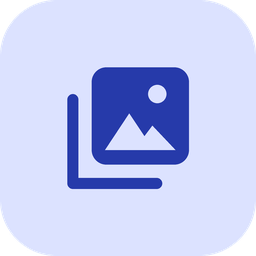
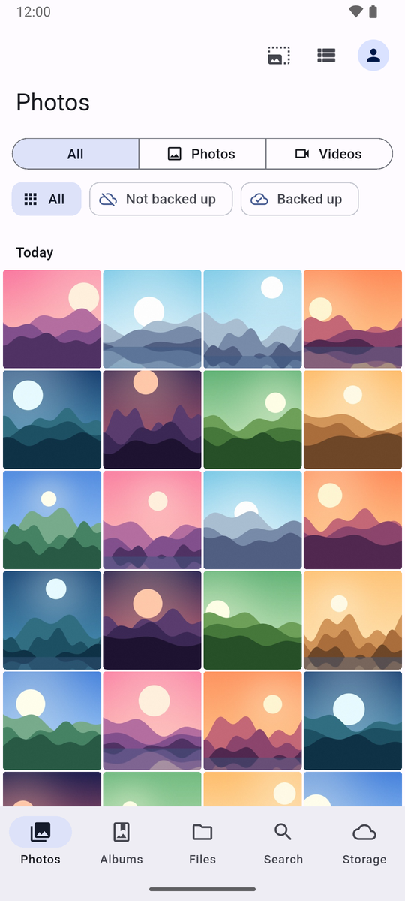
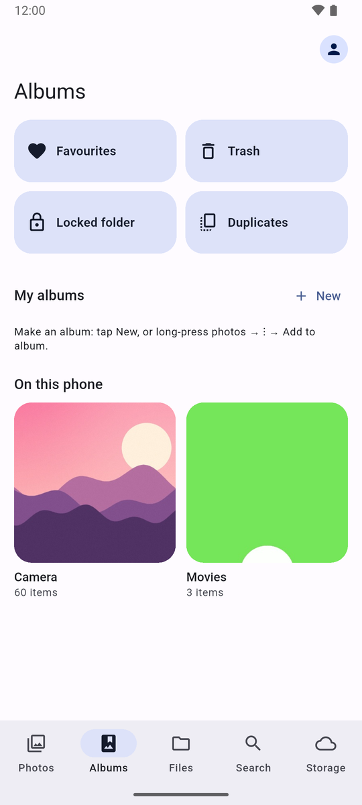
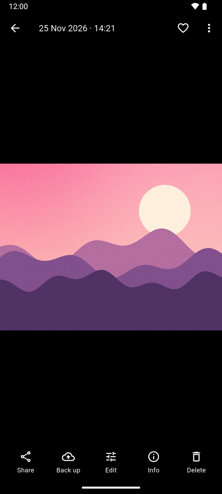
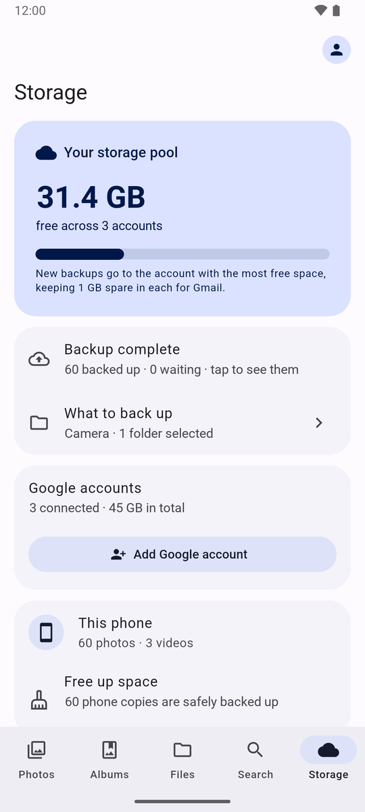

  

<h1 align="center">Unified Gallery</h1>

  One Android gallery for your phone and all your Google accounts — 
  with the free Google Drive storage of every account pooled into one backup space.

  <a href="https://abhi-dbz.github.io/unified-gallery/">Website</a> ·
  <a href="https://abhi-dbz.github.io/unified-gallery/privacy.html">Privacy policy</a>

---

## Screenshots

  
  
  
  

## What it does

- **One storage pool** — add several Google accounts; their free space adds up, and each new
  backup goes to the account with the most room.
- **You choose what's backed up** — pick phone folders or single photos and videos. Nothing
  uploads unless you select it. Wi-Fi only or Wi-Fi + mobile data.
- **Everything in one place** — phone and Google Drive photos together in a Material You
  timeline, with albums, favourites, search and "On this day" memories.
- **Free up space** — remove phone copies that are safely backed up, find duplicates, and
  browse each account's Drive like a file manager to delete what you don't need.
- **Private by design** — no servers, no ads, no analytics. Files travel only between your
  phone and your own Google Drive.

Also: app Trash (30 days), Locked folder with fingerprint, app lock, basic photo editing,
optional video compression before backup, and a home-screen widget showing free space.

## About this repository

This repository hosts the app's public **home page** and **privacy policy**
(served with GitHub Pages). The Android app itself is a personal project shared as an APK.

## Questions

Open an [issue](https://github.com/Abhi-DBZ/unified-gallery/issues).
